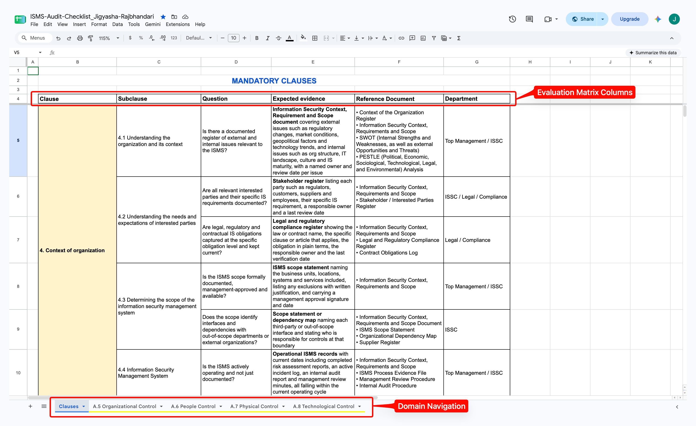

# ISO/IEC 27001:2022 ISMS Stage 2 Implementation Audit Checklist

> A practical verification matrix and operational knowledge base designed for cybersecurity analysts and ISO/IEC 27001 auditors.

---

## Overview

Standard compliance checklists are frequently treated as static, check-the-box documents that exist only on paper. This repository transforms that static approach into an active, high-utility assurance engine. 

Built to streamline compliance assessments, internal audits, and artifact reviews, this framework helps eliminate assessment blind spots, bridges high-level policy design with daily execution, and maintains complete audit traceability across complex environments.

---

## Live Master Audit Workbook

* **Access Google Sheets Workbook:** [ISO 27001 Audit Checklist Tracker](https://docs.google.com/spreadsheets/d/1NWqCI4DKyjAvDjBtd0oHySaFuzPOOHsz_FWthLebA9Q/edit?usp=sharing)

---

## Google Sheets Navigation Guide

The master workbook is organized into specific subsheet tabs separating management clauses from technical and physical control domains. Use the sheet navigation bar at the bottom of the interface to switch between views:

### Sheet Layout & Navigation Overview
> **How to Read This Layout:**
> * **Top Header Area:** Displays the evaluation matrix columns (`Clause`, `Sub-clause`, `Question`, `Expected Evidence`, `Reference Document`, `Department`) used for every audit review.
> * **Bottom Tab Bar:** Allows instant switching across modular control domains (`Mandatory Clauses`, `People Control`, `Physical Control`, `Technological Control`, `Organizational Control`).

*Above: A visual breakdown of the verification columns and bottom tab navigation.*

---

## Subsheet Index & Direct Tab Navigation

| Subsheet / Tab Name | Focus Area & Scope | Direct Link |
| :--- | :--- | :--- |
| **Mandatory Clauses (4 to 10)** | Governance, context, leadership, planning, support, operation, performance evaluation, and improvement | [🔗 Open Clauses Tab](https://docs.google.com/spreadsheets/d/1NWqCI4DKyjAvDjBtd0oHySaFuzPOOHsz_FWthLebA9Q/edit?gid=0#gid=0) |
| **Organizational Controls (A.5)** | Security policies, asset ownership, threat intelligence, supplier relationships, and cloud security | [🔗 Open A.5 Tab](https://docs.google.com/spreadsheets/d/1NWqCI4DKyjAvDjBtd0oHySaFuzPOOHsz_FWthLebA9Q/edit?gid=1633951548#gid=1633951548) |
| **People Controls (A.6)** | Pre-employment screening, employment terms, awareness training, and disciplinary processes | [🔗 Open A.6 Tab](https://docs.google.com/spreadsheets/d/1NWqCI4DKyjAvDjBtd0oHySaFuzPOOHsz_FWthLebA9Q/edit?gid=1343368758#gid=1343368758) |
| **Physical Controls (A.7)** | Perimeters, physical entry, equipment siting, secure areas, and media disposal procedures | [🔗 Open A.7 Tab](https://docs.google.com/spreadsheets/d/1NWqCI4DKyjAvDjBtd0oHySaFuzPOOHsz_FWthLebA9Q/edit?gid=1722546675#gid=1722546675) |
| **Technological Controls (A.8)** | Endpoint security, privileged access management, cryptography, logging, and data backup integrity | [🔗 Open A.8 Tab](https://docs.google.com/spreadsheets/d/1NWqCI4DKyjAvDjBtd0oHySaFuzPOOHsz_FWthLebA9Q/edit?gid=1511707033#gid=1511707033) |

---

## Sheet Architecture & Structure

Each row in the tracking workbook maps directly to standard assurance requirements to maintain high precision during fieldwork:

| Column Field | Description & Purpose |
| :--- | :--- |
| **Sub-Control** | The specific ISO/IEC 27001:2022 clause or control reference (e.g., A.6.1 Screening) |
| **Question** | Probing inquiries designed to test operational effectiveness |
| **Expected Evidence** | Tangible artifacts, logs, or records required to validate compliance |
| **Reference Document** | The specific policy, procedure, or register to inspect |
| **Department** | The business unit or owner accountable for the control |

---

## Conclusion & Project Origin

> **Origin Note:** The underlying master audit tracking sheets were originally conceptualized and structured in **July 2026** for live ISMS implementation fieldwork. This GitHub repository was subsequently established to serve as the professional documentation and navigation layer, bridging practical security assurance execution with transparent, open-source portfolio standards.
